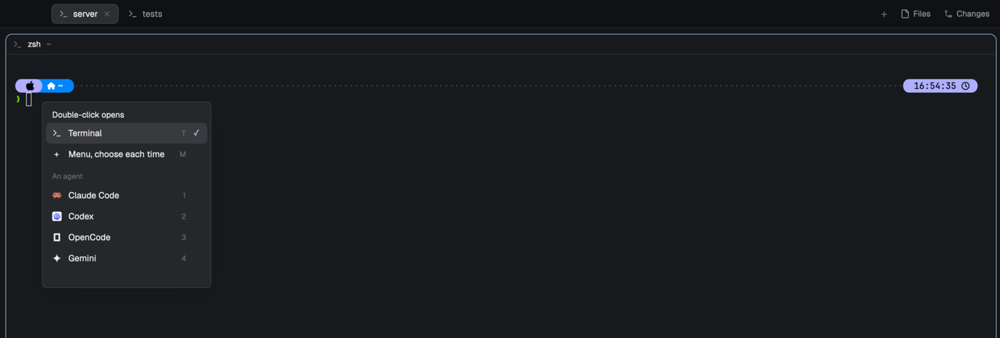

# Double-tap

Herdr's tab bar, plus one gesture: **double-click the empty space beside your tabs** to
start something new. By default a terminal opens in a new tab. Click that space once
and you choose what a double-click does from then on:

- **Terminal**: a new tab with your shell.
- **Menu, choose each time**: the same menu the **+** button opens, right where you
  double-clicked.
- **An agent**: one of your installed agents (Claude Code, Codex, …) starts in a new tab.



The choice is kept in Herdr's shared state (`doubletap.action`), so it survives restarts.
You can also open the choice from a key: bind `mod.open:doubletap` in `keys.json`.

Everything else is Herdr's tab bar as of tabs 0.1.11. A mod can't add to another mod, so
this is a copy (`mod.clone`), and Herdr's updates to its own tab bar don't reach it by
themselves: `npm test` fails when the installed Herdr ships a different tab bar, see
[upstream/](upstream/README.md). The Files/Changes panel each space remembers is kept per
tab bar, so this layout and Herdr's main layout remember it separately.

## Install

From [herdr.dev/mods](https://herdr.dev/mods): ask your agent to add
`herdr.dev/mods/dmazlum/doubletap`. That copies `mods/doubletap/`; the mod shows up once a
layout's tab bar block names it (below). Or from this repo:

```sh
git clone https://github.com/dmazlum/herdr-doubletap.git
cd herdr-doubletap
npm run install-layout
```

This copies the mod to `~/.config/herdr-app/mods/doubletap`, makes a `doubletap` layout
(a clone of Herdr's main layout, via `layout.clone`) whose tab bar is this mod, and
switches to it. Back to Herdr's own: `npm run remove-layout -- doubletap`, or pick
another layout in Settings.

## In other layouts

What a double-click does is one choice for every layout (`doubletap.action`), and the
choice popup is always this mod's. What differs is who draws the tab bar.

**A layout with Herdr's tab bar** (a block with `"content": { "mod": "tabs" }`, like
main and most clones of it):

```sh
npm run install-layout -- my-layout
```

A layout of your own is changed in place; the original is kept as
`layouts/my-layout.json.before-doubletap`, and `npm run remove-layout -- my-layout`
puts Herdr's tab bar back. A layout Herdr ships is cloned first as
`<name>-doubletap`, since Herdr restores its own layouts when they're edited. Or make
the change by hand: `"mod": "tabs"` → `"mod": "doubletap"` in the tab bar block.

**A layout whose tab bar is its own mod** (Terminals, Herdr 98, most custom layouts):
the script tells you, and names the layout's mods. A mod can't add to another mod or
import from another mod's folder, so that tab bar gets the gesture from two files you
copy into it:

```sh
npm run sync                                          # the popup lives in doubletap
npm run vendor -- ~/.config/herdr-app/mods/my-tabs     # copies bar.js and tap.js
```

Run `vendor` again after updating this repo to refresh the copies. For a tab bar Herdr
ships, `mod.clone` it first (and `layout.clone` the layout to point at the clone).
Then, in the tab bar's `main.js`:

```js
import { EmptyBar } from "./bar.js";

export default class MyTabs extends View {
  init(props, cx) {
    this.dt = new EmptyBar(cx);
  }
  render() {
    this.dt.track(); // notes when the window comes forward, so that click opens nothing
    return h_flex()
      // The empty part of the bar, usually the row the tabs sit in:
      .child(h_flex().id("tab-row").flex_1()
        .on_mouse_down("left", (e, cx) => this.dt.down(e, cx))
        .on_mouse_up("left", (e, cx) => this.dt.up(e, cx))
        .children(tabs.map(tab => div().id(tab.id)
          // Every tab and button stops its press and cancels ours:
          .on_mouse_down("left", (e, cx) => { cx.stop_propagation(); this.dt.cancel(); /* … */ }))));
  }
}
```

Presses that reach the row are the empty bar's; that's why each tab and button stops its
own and calls `cancel()`. A bar in a `window_drag` block keeps dragging the window, and
its double-click starts your choice instead of maximizing.

## How it tells clicks apart

- The empty bar is also where you drag the window. A double-click there would normally
  maximize the window; Double-tap takes the second press first, so it opens your choice
  instead. Dragging the window still works.
- A single click waits as long as your system's double-click interval (macOS: System
  Settings → Mouse/Trackpad, 500 ms by default) for a second one before opening the choice
  popup, so a double-click never shows the popup first.
- A triple-click starts one thing, not two.
- A press that moves more than 4 px before release is a drag, not a click.
- The click that brings the Herdr window to the front opens nothing.
- An agent remembers the machine it was picked on. Double-click in a space on another
  machine and it starts as that machine knows it; if it isn't installed there, you get a
  warning instead of a tab that fails.
- Clicks on tabs, **+**, Files, Changes and the window buttons behave as before.

In the choice popup, `T` picks Terminal, `M` the menu, and `1`–`9` an agent.

## Develop

```sh
npm run sync     # copy the mod into Herdr; it reloads within a second
npm test         # logic tests under Node, with herdr/gpui stubbed
herdr-app check ~/.config/herdr-app/mods/doubletap
```

Copy, don't symlink: Herdr doesn't reload a symlinked mod folder when its files change.
See [RECIPE.md](RECIPE.md) for the full behavior.

## What it runs

Once per tab bar, on macOS: `defaults read -g com.apple.mouse.doubleClick`, to wait as
long as your double-click interval. No network, and no files outside its own folder.

## License

MIT
