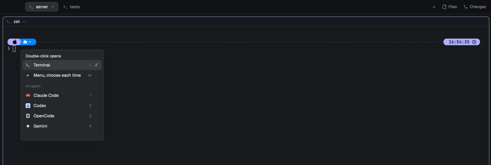

# Double-tap

Herdr's tab bar with one more gesture: double-click the empty space beside your tabs and
a new terminal opens in a new tab. Click that space once and a small popup asks what a
double-click should open from then on: a terminal, the same menu the **+** button opens
(right where you double-clicked), or one of your installed agents. Everything else about
the tab bar is Herdr's.

## What you see

- **The tab bar** is Herdr's shipped tab bar (`tabs` 0.1.11) unchanged: 42 px, `chrome`
  background, 1 px `border` bottom line; tabs 29 px high with 10 px side padding, 7 px
  radius, 12.8 px text, the active one `raised` with a `border` outline and a × to close;
  program icons, a working spinner, a blocked/done dot; then **+**, **Files** and
  **Changes** at the right (and window buttons where the system draws none). The empty
  space is the row the tabs sit in, from the last tab to the **+**.
- **The choice popup** (250 px wide) opens where you clicked: `popover` background, 5 px
  padding, 12.8 px text, as tall as its rows (`150 + max(1, agents) × 31` px, at most
  460 px; the agent list scrolls beyond that). Top to bottom:
  - "Double-click opens", 12 px semibold `foreground`.
  - **Terminal** (`icons/shell.svg`), hint `T`.
  - **Menu, choose each time** (a `+`), hint `M`.
  - "An agent", 11 px `dim`, then each agent installed on the shown space's machine with
    its icon (tinted when the program table says so) and a hint `1`–`9`. While they load:
    "Checking installed agents…"; on failure "Could not load agents"; none: "No agents
    installed".
  - Rows are 31 px with 9 px side padding and 7 px radius; the current choice has a
    `selected` background and an `accent` ✓ at the right; `hover` on hover.

## How it behaves

- **Double-click the empty bar:** starts the choice at once in the active space:
  - Terminal (the default, also when nothing or something unreadable is stored):
    `tab.new {space}`.
  - Menu: Herdr's `new-menu` popup (250 × 512) at the click.
  - An agent: `tab.new {name, space, argv}` with the command it was picked with. If the
    active space is on another machine than the one shown when it was picked, the
    agent is looked up there by key (`knownAgents({on})`) and started with that machine's
    command; if it isn't installed there, a warning toast "<name> isn't installed on
    <machine | this computer>" appears and nothing starts.
  - The double-click doesn't maximize the window, though the bar sits in a `window_drag`
    block. A triple-click starts one thing.
- **Click the empty bar once:** after the system's double-click interval (macOS
  `defaults read -g com.apple.mouse.doubleClick`, 500 ms when unset, kept within
  200–2000 ms, plus 30 ms) with no second press, the choice popup opens at the click.
  Nothing opens when the press moved more than 4 px (a window drag), when it was the
  press that brought the window forward (window inactive, or active for under 300 ms),
  or when a tab or button was pressed in the meantime.
- **In the popup:** click a row, or press `T`, `M` or `1`–`9`: the choice is stored and
  the popup closes. Esc or a click outside closes it unchanged. The choice is shared by
  every copy and layout and survives restarts.
- **Tabs and buttons** work exactly as Herdr's: click selects, double-click renames,
  drag reorders, right-click opens the tab menu, the wheel switches tabs.
- `mod.open:doubletap` (bind it to a key if you like) opens the same popup.
- Agent statuses look as in Herdr's tab bar: working spins, blocked and done show a dot.

## Built from

- `mods/doubletap/` only; `mod.json`: `{ "place": "none", "title": "Double-tap tabs",
  "overlay": { "kind": "popup", "width": 250, "height": 460 } }`. A layout shows it by
  putting `"content": { "mod": "doubletap" }` in its tab bar block, in place of `"tabs"`.
- `main.js`: `mod.clone` of the shipped `tabs` mod (the copy rewrites its asset paths to
  `mods/doubletap/win-*.svg`), plus: an `EmptyBar` made in `init`; `track()` at the top
  of `render`; the `tab-scroll` row gets `on_mouse_down`/`on_mouse_up` (left) wired to
  `down`/`up`; every tab's and button's left press also calls `cancel()`; the **+** button
  opens `NEW_MENU`. When `props().view === "settings"` or `props().overlay` is set, the
  same class draws the popup (`settings.js`) instead of the bar.
- `bar.js`, `EmptyBar`: `Taps` for clicks, a `cx.timer.after` for the wait, `exec` for
  the interval, then `run`, `openOverlay`, `knownAgents` and `notify` as above. It and
  `tap.js` import only `herdr` and each other, so other tab bar mods can copy them in.
- `tap.js`: plain logic: the stored value (`shared("doubletap.action")`:
  `{kind: "terminal"}`, `{kind: "menu"}` or `{kind: "agent", key, name, run, machine}`),
  `launch`, `resolveAgent`, `waitFrom`, `Taps`.
- `settings.js`: the popup; `knownAgents({on: machine})` filtered to installed, then
  `setShared("doubletap.action", …)` and `closeOverlay(props().overlay)`.
- Shipped things used: `new-menu` (the + menu), `menu` (tab menu), `icons/shell.svg`,
  `mods/workspace-chrome/spinner.svg`, `mods/pane/close.svg`, `mods/files/file.svg`,
  `mods/changes/changes.svg`.
- Runs one program: `defaults read -g com.apple.mouse.doubleClick`, once per bar, on
  macOS. No network, no files outside its folder.

## Watch out

- A mod can't add to another mod, so this is a whole copy of Herdr's tab bar; Herdr's
  later changes to `tabs` don't reach it. The repo keeps the cloned original in
  `upstream/tabs.main.js` and a test fails when the installed one differs.
- Herdr refuses imports from another mod's folder (`../doubletap/…`). A different tab bar
  gets the gesture by copying `bar.js` and `tap.js` into its own folder.
- Presses that reach the empty row are the bar's: every tab and button must stop its own
  press and call `cancel()`, or a click on it opens the popup.
- The popup frame is as tall as its content, capped by the overlay height; a fixed height
  smaller than the content clips the list without a scrollbar.
- `click_count` follows the system's double-click interval, so the single-click wait must
  too, or a slow double-click shows the popup first.
- Only `click_count === 2` starts the choice; `>= 2` starts it again on a triple-click.
- A window drag never delivers its release, so the press is only remembered, never acted
  on, until a release within 4 px arrives.
- Each mod has its own `localStorage`: the Files/Changes panel each space remembers is
  kept apart from Herdr's tab bar's.
- Herdr restores its shipped layouts when they're edited: point a clone at this mod.

## Done when

- `herdr-app check ~/.config/herdr-app/mods/doubletap` passes.
- In a layout whose tab bar block is `doubletap`, double-clicking the empty bar opens a
  new terminal tab, and the window doesn't maximize.
- A single click there opens the popup after about half a second, at the click, with
  Terminal ✓; dragging the window from there opens nothing.
- Picking Menu, then double-clicking, opens the + menu at the click; picking an agent,
  then double-clicking, starts it in a new tab.
- A triple-click opens one tab; clicking a tab right after the empty bar opens no popup.
- `mod.open:doubletap` opens the popup; the choice is still set after restarting Herdr.
- `npm test` passes.
